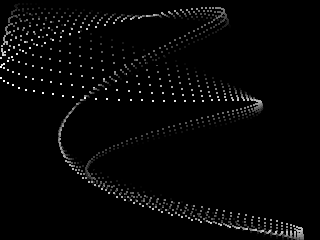
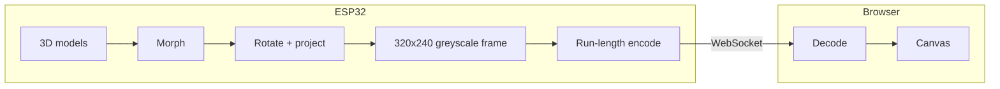

# morph3d_esp32

An ESP32 renders a rotating 3D point cloud that smoothly morphs between shapes, and streams it live to your browser over WebSocket. No display hardware needed: connect to the ESP32's Wi-Fi, open a web page, and watch.

<!-- TODO: add a demo GIF, e.g.  -->

## Features

- **Software 3D renderer on the ESP32:** rotation around three axes, perspective projection, and depth shading. Nearer points are brighter.
- **Shape morphing:** a sphere, a 3D Lissajous curve and a torus, each made of 256 points. The current shape rotates for about 4 seconds, then morphs into a random other shape.
- **Motion trails:** every frame fades the previous one instead of clearing it.
- **Live streaming at up to 60 FPS** to any number of browsers, using a binary WebSocket and simple run-length encoding to keep frames small.
- **No app to install:** the viewer page is served by the ESP32 itself.
- **Two Wi-Fi modes:** the ESP32 can create its own access point, join your existing network, or both.

## Hardware

- Any ESP32 board. The project targets `esp32dev` (ESP32-WROOM-32 DevKit).
- A USB cable.

That's it.

## Getting started

### 1. Prerequisites

- [VS Code](https://code.visualstudio.com/) with the [PlatformIO IDE](https://platformio.org/install/ide?install=vscode) extension, or the PlatformIO CLI.

PlatformIO downloads the ESP32 toolchain and the libraries (`AsyncTCP`, `ESPAsyncWebServer`) automatically on the first build.

### 2. Clone the repository

```bash
git clone https://github.com/<your-username>/morph3d_esp32.git
cd morph3d_esp32
```

### 3. Configure Wi-Fi credentials

Credentials are kept out of git. Create your own copy of the template:

```bash
cp src/secrets.example.h src/secrets.h
```

Then edit `src/secrets.h`:

```cpp
static const char WIFI_NETWORK_SSID[] = "your_wifi_ssid";      // network to join
static const char WIFI_NETWORK_PASS[] = "your_wifi_password";

static const char SOFT_AP_SSID[] = "morph3d";                  // network the ESP32 creates
static const char SOFT_AP_PASS[] = "at_least_8_chars";
```

The access point password must be at least 8 characters, or the ESP32 won't start the access point.

### 4. Choose the Wi-Fi mode

In [`platformio.ini`](platformio.ini), enable one or both modes in `build_flags`:

```ini
build_flags =
    -std=gnu++17
    -D USE_SOFT_AP          ; ESP32 creates its own network (default)
    ; -D USE_WIFI_NETWORK   ; ESP32 joins your existing network
```

### 5. Build and upload

In VS Code, click **Upload** in the PlatformIO toolbar, or run:

```bash
pio run --target upload
pio device monitor
```

The serial monitor runs at 115200 baud and prints the IP address to open.

### 6. Watch

| Mode | Connect to | Open in browser |
|---|---|---|
| Soft AP | Wi-Fi network `morph3d` | `http://192.168.4.1` |
| Existing network | Your usual Wi-Fi | The IP printed on the serial monitor |

The page shows the connection status and the received frame rate, and reconnects automatically if the connection drops. Rendering only runs while at least one browser is connected.

## How it works



1. **Models** ([`Models.cpp`](src/Models.cpp)): each shape is generated at startup as 256 points with fixed-point coordinates (scaled by 4096).
2. **Morphing** ([`DrawUtils.cpp`](src/DrawUtils.cpp)): point *i* of the source shape moves linearly towards point *i* of the target shape over 64 frames (`MORPH_STEP_CNT`), after the current shape has been held for 256 frames (`NO_MORPH_STEP_CNT`).
3. **Rotation and projection:** points rotate around the Z, Y and X axes at different speeds, then are projected with perspective.
4. **Drawing:** points are sorted back to front and drawn as 2×2 pixels. Brightness, from 64 to 255, depends on depth.
5. **Encoding:** the 76,800-byte frame is run-length encoded as `[colour, run length]` byte pairs. Mostly-black frames shrink to a few kilobytes.
6. **Streaming** ([`WebModule.cpp`](src/WebModule.cpp)): frames are sent over a binary WebSocket at `/ws`. A frame is skipped while a client still has unsent data queued, so slow clients don't exhaust the ESP32's memory.
7. **Viewer:** the embedded web page decodes the runs into an RGBA canvas.

## Project structure

```
src/
├── main.cpp             Setup, frame loop and timing, heap diagnostics
├── Models.cpp/.h        Generates the 3D point models
├── DrawUtils.cpp/.h     Morphing, rotation, projection, rasterising, RLE encoding
├── WebModule.cpp/.h     HTTP server, WebSocket, embedded viewer page
├── WiFiModule.cpp/.h    Access point / station setup
├── secrets.example.h    Credentials template (copy to secrets.h)
└── secrets.h            Your credentials (git-ignored)
platformio.ini           Board, framework and library configuration
```

## Customising

| What | Where |
|---|---|
| Target frame rate | `TARGET_FPS` in [`main.cpp`](src/main.cpp) |
| Resolution | `WIDTH` / `HEIGHT` in [`DrawUtils.h`](src/DrawUtils.h), and the matching constants in the page in `WebModule.cpp` |
| Trail length | Fade amount in `fadeOutFrame()` in `DrawUtils.cpp` |
| Hold and morph duration | `NO_MORPH_STEP_CNT` (frames a shape is held) and `MORPH_STEP_CNT` (frames a morph takes) in [`DrawUtils.h`](src/DrawUtils.h) |
| New shapes | Add a generator in `createModels()` and increase `MODEL_COUNT` in [`Models.h`](src/Models.h). Every model must have exactly `POINTS_PER_MODEL` points. |

## Built with

- [PlatformIO](https://platformio.org/) and the [Arduino core for ESP32](https://github.com/espressif/arduino-esp32)
- [ESPAsyncWebServer](https://github.com/ESP32Async/ESPAsyncWebServer) and [AsyncTCP](https://github.com/ESP32Async/AsyncTCP)
